# Hello-devops

Aplicação Spring Boot reutilizada em duas atividades de DevOps. Cada atividade
possui sua própria seção de documentação e evidências abaixo.

**Navegação:**

- [Atividade anterior — Docker, GitHub Actions e GHCR](#atividade-docker): build, execução e publicação das versões 1.0 e 2.0.
- [Atividade atual — Pipeline DevSecOps](#atividade-devsecops): ferramentas de segurança, PR bloqueado, correção, SBOM e publicação após os checks.

**Endpoint da aplicação:** `GET /hello`.

---

<a id="atividade-docker"></a>

## Atividade anterior — Docker, GitHub Actions e GHCR

**Objetivo:** construir e executar a aplicação em containers, automatizar o
pipeline no GitHub Actions e publicar as versões 1.0 e 2.0 no GHCR.

**Evidências desta atividade:** comandos de build e execução, pipelines das
versões 1.0 e 2.0 e imagens publicadas no registry. Os registros abaixo
correspondem à entrega original dessa atividade.

### Versão 1.0 — Hello World

#### Build local

A imagem da versão 1.0 foi construída localmente a partir do `Dockerfile`.

```console
$ docker build -t hello-devops-local:1.0 .
[+] Building 1.4s (14/14) FINISHED
...
=> [builder 5/5] RUN mvn clean package -DskipTests
=> [stage-1 3/3] COPY --from=builder /app/target/*.jar app.jar
=> naming to docker.io/library/hello-devops-local:1.0
```

Imagem criada:

```console
$ docker images
IMAGE                    ID             DISK USAGE   CONTENT SIZE
hello-devops-local:1.0   20afd9a495c9        523MB          138MB
```

#### Execução local da versão 1.0

```console
$ docker run --rm -d --name hello-devops-local-v1 -p 8080:8080 hello-devops-local:1.0

d5121bd07c67cd09e6ce3adce197a5d4907f9b9b0947727d2577a958fcf50987
```

Container em execução:

```console
$ docker ps
CONTAINER ID   IMAGE                    COMMAND               STATUS         PORTS                                         NAMES
d5121bd07c67   hello-devops-local:1.0   "java -jar app.jar"   Up 6 seconds   0.0.0.0:8080->8080/tcp, [::]:8080->8080/tcp   hello-devops-local-v1
```

Teste do endpoint:

```console
$ curl http://localhost:8080/hello
Hello World
```

---

#### Pipeline GitHub Actions — versão 1.0

O push para a branch principal disparou automaticamente o workflow do GitHub Actions, responsável pelo build, teste e publicação da imagem no GitHub Container Registry.

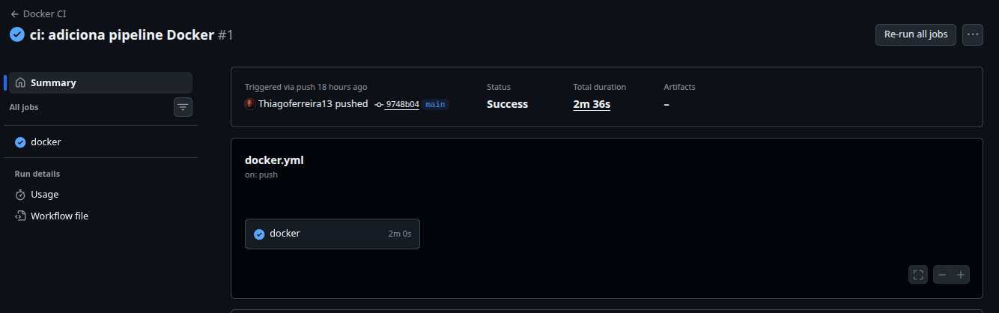
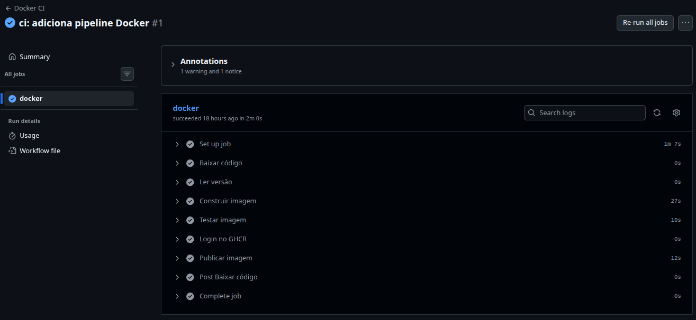

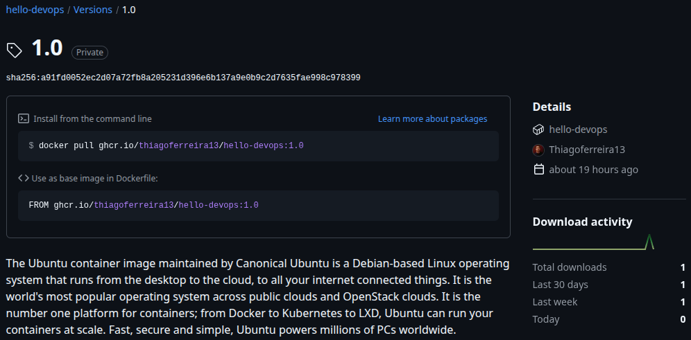

---

#### Imagem 1.0 no GitHub Container Registry

Imagem publicada:

```text
ghcr.io/thiagoferreira13/hello-devops:1.0
```

Download da imagem publicada:

```console
$ docker pull ghcr.io/thiagoferreira13/hello-devops:1.0
1.0: Pulling from thiagoferreira13/hello-devops
Digest: sha256:a91fd0052ec2d07a72fb8a205231d396e6b137a9e0b9c2d7635fae998c978399
Status: Image is up to date for ghcr.io/thiagoferreira13/hello-devops:1.0
ghcr.io/thiagoferreira13/hello-devops:1.0
```

#### Execução da imagem 1.0 baixada do Registry

```console
$ docker run --rm -d --name hello-devops-registry-v1 -p 8080:8080 ghcr.io/thiagoferreira13/hello-devops:1.0

18a631f19a319d6893e32bb8a2432df471642aff73f1a19c0fce25edd0b170ae
```

Container em execução:

```console
$ docker ps
CONTAINER ID   IMAGE                                       COMMAND               STATUS         PORTS                                         NAMES
18a631f19a31   ghcr.io/thiagoferreira13/hello-devops:1.0   "java -jar app.jar"   Up 4 seconds   0.0.0.0:8080->8080/tcp, [::]:8080->8080/tcp   hello-devops-registry-v1
```

Teste do endpoint:

```console
$ curl http://localhost:8080/hello
Hello World
```

---

### Versão 2.0 — Hello World 2

Após a alteração da aplicação, uma nova versão foi criada com a tag `2.0`.

#### Build local

Imagem criada localmente:

```console
$ docker images
IMAGE                    ID             DISK USAGE   CONTENT SIZE
hello-devops-local:2.0   a3aa199b3f23        523MB          138MB
```

#### Execução local da versão 2.0

```console
$ docker run --rm -d --name hello-devops-local-v2 -p 8080:8080 hello-devops-local:2.0

a50593cb26c84992f58d651bd29a02021ebfb36bfd53547664d776d122924e2f
```

Teste do endpoint:

```console
$ curl http://localhost:8080/hello
Hello World 2
```

---

#### Pipeline GitHub Actions — versão 2.0

O novo push após a alteração da aplicação disparou novamente o workflow, construindo, testando e publicando a versão `2.0`.

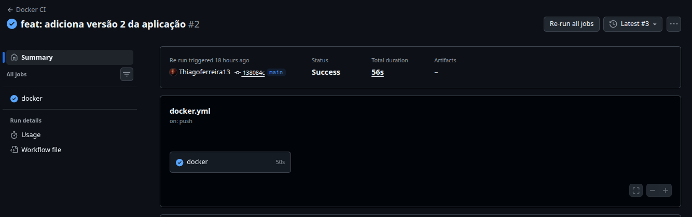
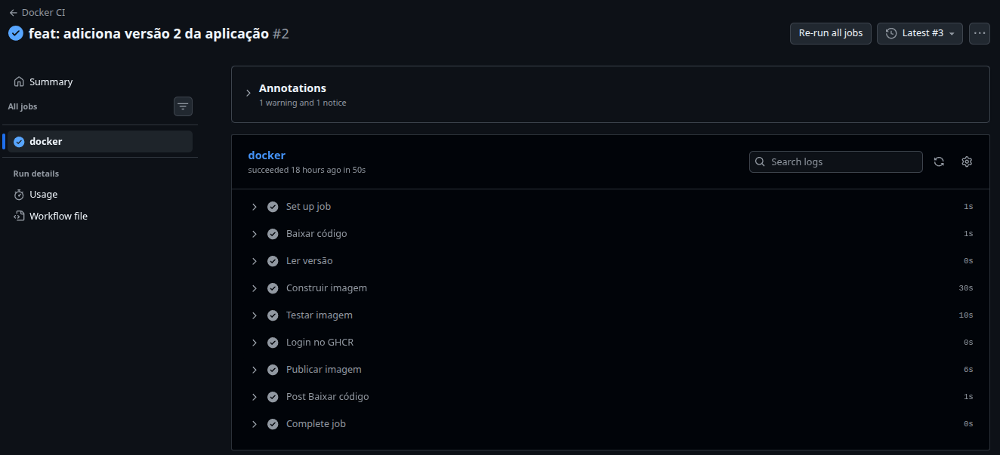

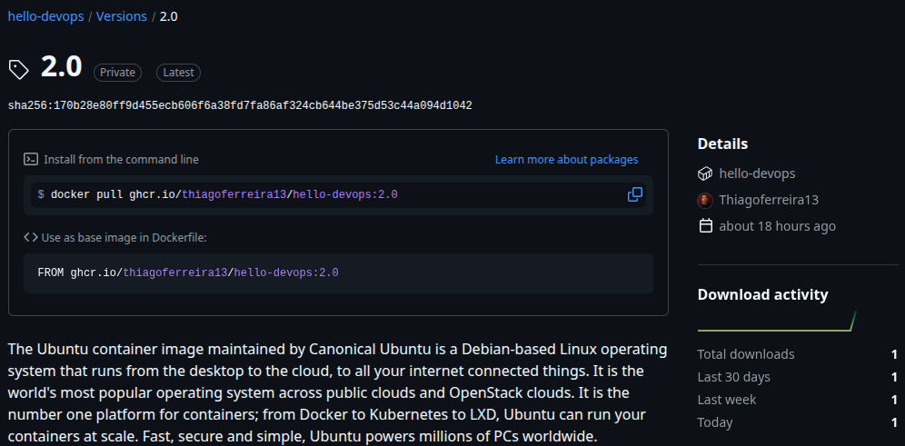

---

#### Imagem 2.0 no GitHub Container Registry

Imagem publicada:

```text
ghcr.io/thiagoferreira13/hello-devops:2.0
```

Download da imagem publicada:

```console
$ docker pull ghcr.io/thiagoferreira13/hello-devops:2.0
2.0: Pulling from thiagoferreira13/hello-devops
Digest: sha256:170b28e80ff9d455ecb606f6a38fd7fa86af324cb644be375d53c44a094d1042
Status: Image is up to date for ghcr.io/thiagoferreira13/hello-devops:2.0
ghcr.io/thiagoferreira13/hello-devops:2.0
```

#### Execução da imagem 2.0 baixada do Registry

```console
$ docker run --rm -d --name hello-devops-registry-v2 -p 8080:8080 ghcr.io/thiagoferreira13/hello-devops:2.0

e3a0fa70502658fdd315a1622ac48bb78c1da136eac6a882faaf2a68079fe2b5
```

Container em execução:

```console
$ docker ps
CONTAINER ID   IMAGE                                       COMMAND               STATUS         PORTS                                         NAMES
e3a0fa705026   ghcr.io/thiagoferreira13/hello-devops:2.0   "java -jar app.jar"   Up 5 seconds   0.0.0.0:8080->8080/tcp, [::]:8080->8080/tcp   hello-devops-registry-v2
```

Teste do endpoint:

```console
$ curl http://localhost:8080/hello
Hello World 2
```

---

### Versões publicadas no GHCR

O GitHub Container Registry contém as duas versões exigidas pela atividade:

```text
ghcr.io/thiagoferreira13/hello-devops:1.0
ghcr.io/thiagoferreira13/hello-devops:2.0
```

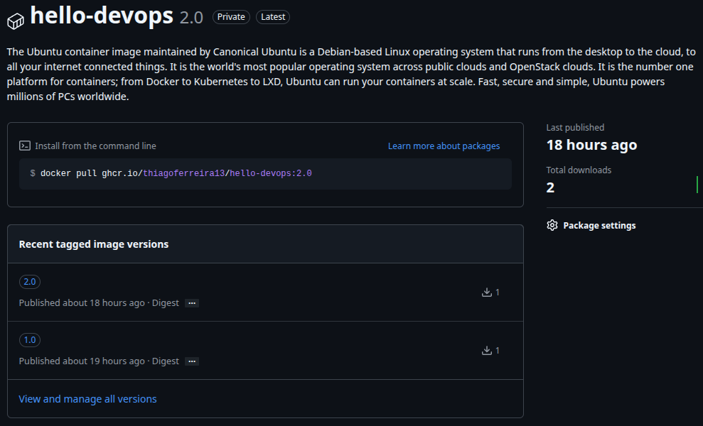

---

<a id="atividade-devsecops"></a>

## Trabalho Prático — Pipeline DevSecOps com GitHub Actions

**Objetivo:** acrescentar segurança ao pipeline existente, impedindo a integração
e a publicação de alterações que reprovem nas verificações obrigatórias.

**Evidências desta atividade:** PR #2 bloqueado por uma CVE, aprovação após a
correção no mesmo PR, SBOM publicado como artifact e execução na main com
publicação no GHCR. As capturas principais são os arquivos `04` a `08`.

### Links da entrega e das execuções

- [Repositório](https://github.com/Thiagoferreira13/hello-devops) e [workflow YAML](.github/workflows/docker.yml).
- [PR #2 — bloqueio e correção](https://github.com/Thiagoferreira13/hello-devops/pull/2).
- [Execução #7 — vulnerabilidade bloqueada](https://github.com/Thiagoferreira13/hello-devops/actions/runs/40599557403), commit `44e003c`.
- [Execução #8 — aprovada após correção](https://github.com/Thiagoferreira13/hello-devops/actions/runs/40601046980), commit `24a4332`.
- [Execução #9 — main e publicação aprovadas](https://github.com/Thiagoferreira13/hello-devops/actions/runs/40601804353), commit `bb31486`.
- [SBOM SPDX JSON baixado do artifact da execução #8](docs/evidencias/sbom-a0ddc872e3c5a3da171edcc4ebd66cede09c0b96/sbom.spdx.json).

### Ferramentas e regras do pipeline

O workflow `.github/workflows/docker.yml` roda na abertura e atualização de PRs
e em pushes na `main`. Preserva construção Docker, teste HTTP de `/hello` e
publicação no GHCR. As execuções #7, #8 e #9, vinculadas acima, demonstram
o bloqueio, a correção e a publicação após aprovação dos checks.

| Check | Verificação e regra de bloqueio |
| --- | --- |
| Gitleaks | Histórico completo (`fetch-depth: 0`, `git --log-opts="--all"`). Segredo detectado reprova; relatório com valores ocultados. |
| SonarCloud Quality Gate | Testes Maven com Java 25, cobertura JaCoCo, análise SAST e espera pelo resultado do gate. Falha de testes, análise ou gate impede publicação. |
| Docker, Trivy e SBOM | Build, teste HTTP, Syft e Trivy nas dependências Maven e na imagem. HIGH/CRITICAL com correção disponível bloqueiam. |
| Publicar GHCR | Somente push na main, após sucesso de todos os checks. Publica a mesma imagem analisada, sem reconstruí-la. Nunca publica imagens de PR. |

Durante os testes do pipeline, o Trivy recebeu um erro `429` do Maven Central ao tentar baixar as dependências novamente. Para resolver isso, passei a aproveitar o cache Maven criado no build Docker, copiando-o para `~/.m2/repository` antes da análise. Se alguma dependência não estiver no cache, ela ainda pode ser consultada remotamente.

Configurei o Trivy para bloquear vulnerabilidades **HIGH e CRITICAL com correção disponível**. As de nível LOW e MEDIUM, assim como as que ainda não têm correção, aparecem nos relatórios, mas não impedem a execução. Os relatórios completos são salvos em JSON. Se alguma ferramenta apresentar erro, o job também falha.

O script `scripts/install-security-tools.sh` instala Gitleaks, Trivy e Syft com versões definidas e confere o SHA-256 dos arquivos baixados. O Syft analisa a imagem construída e gera o SBOM em SPDX JSON, com a lista de componentes e suas versões.

### SonarCloud

Usei a organização `thiagoferreira13` e o projeto `Thiagoferreira13_hello-devops`. O token fica salvo no secret `SONAR_TOKEN` do GitHub. A análise é executada pelo GitHub Actions.

Mantive o Quality Gate **Sonar way**, que avalia o código novo com estes critérios:

- Classificação A em segurança, confiabilidade e manutenibilidade.
- Todos os novos security hotspots revisados.
- Cobertura de testes de pelo menos 80%.
- Duplicação de código de no máximo 3%.

Também mantive a configuração padrão que dispensa a verificação de cobertura e duplicação quando a alteração tem menos de 20 linhas novas. Os outros critérios continuam sendo avaliados.

Para definir código novo, selecionei **Previous version**. O Sonar usa a versão do `pom.xml` como referência, enquanto o arquivo `VERSION` define a tag da imagem Docker. Nos PRs, a análise considera as alterações propostas.

### Artifacts e publicação

- `gitleaks-report`: relatório de segredos com valores ocultados.
- `testes-e-cobertura`: testes Maven e cobertura JaCoCo.
- `trivy-reports`: relatórios completos e tabelas dos gates, inclusive em reprovação.
- `sbom-<sha>`: arquivo `sbom.spdx.json` gerado com Syft.
- `imagem-aprovada`: transporte da imagem entre jobs em pushes; retenção de 1 dia.

O GHCR usa o `GITHUB_TOKEN` automático, com `packages: write` apenas no job de
publicação. O pacote `hello-devops` precisa permitir acesso a este repositório
em suas configurações de Actions. Os antigos secrets `REGISTRY_USERNAME` e
`REGISTRY_TOKEN` não são utilizados pelo workflow novo.
Tags publicadas: conteúdo de `VERSION` e `sha-<commit>`.

### Proteção da main

A main exige Pull Request, branch atualizada e aprovação dos checks
`Gitleaks`, `SonarCloud Quality Gate` e `Docker, Trivy e SBOM`.
A opção de impedir bypass está habilitada inclusive para administradores.
A captura do PR bloqueado demonstra a aplicação da regra.

A dependência vulnerável ficou restrita ao PR #2: o gate reprovou e o merge
foi impedido. Após atualizar a dependência no mesmo PR, os checks passaram,
o merge foi realizado e a execução #9 publicou a imagem corrigida.
A configuração do workflow impede publicação de imagens em eventos de PR.

### Demonstração de bloqueio e correção

Na branch `test/dependencia-vulneravel`, foi adicionada intencionalmente
`org.apache.commons:commons-text:1.9`. A execução do PR identificou
**CVE-2022-42889**, de severidade **CRITICAL**, com correção em **1.10.0**,
tanto no `pom.xml` quanto no JAR da imagem. O gate terminou com código 1,
o check obrigatório reprovou e o botão de merge ficou desabilitado.
A publicação no GHCR foi ignorada por se tratar de um PR.

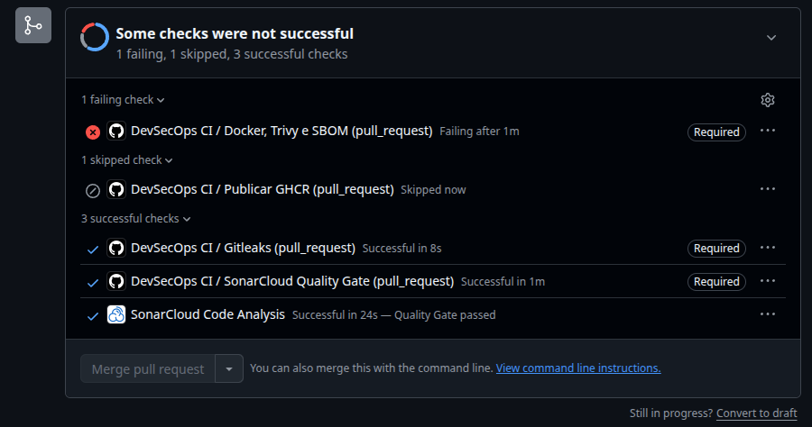
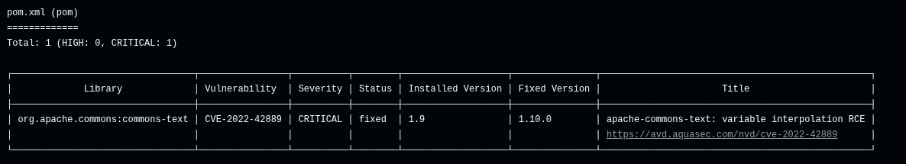

[Log da execução bloqueada](docs/evidencias/trivy-bloqueio.txt).

A correção atualizou a dependência para **1.10.0**, no mesmo PR, mantendo os
critérios de bloqueio. Não houve merge da versão vulnerável na main.

### Correção da vulnerabilidade

Após atualizar o Apache Commons Text de `1.9` para `1.10.0`, os checks obrigatórios passaram sem desativar nenhuma regra de segurança.

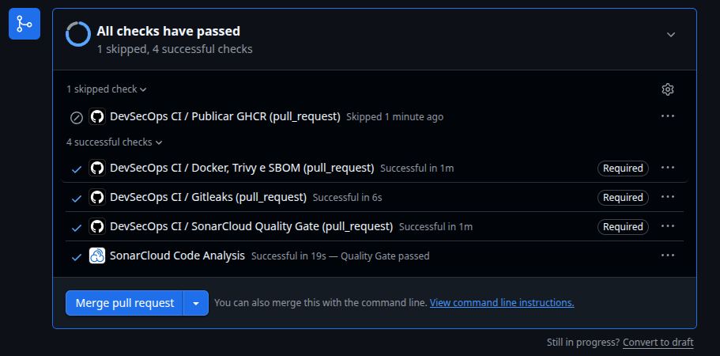

### SBOM publicado como artifact

Na execução aprovada #8, o artifact
`sbom-a0ddc872e3c5a3da171edcc4ebd66cede09c0b96` contém o inventário da imagem
construída para o PR. O arquivo foi baixado e preservado neste repositório:
[SBOM completo em SPDX JSON](docs/evidencias/sbom-a0ddc872e3c5a3da171edcc4ebd66cede09c0b96/sbom.spdx.json).


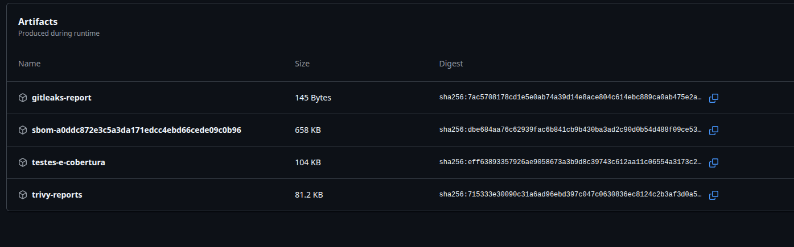

### Publicação após aprovação dos checks

Após o merge do PR #2, a execução #9 na main terminou com sucesso.
Gitleaks, SonarCloud e Docker/Trivy/SBOM passaram antes da publicação no GHCR.
A imagem publicada é a mesma construída e analisada pelo pipeline.

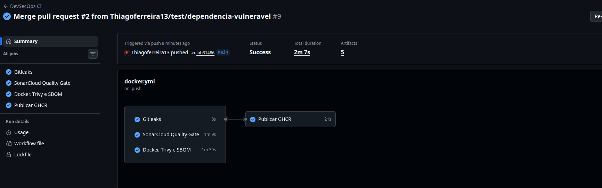
